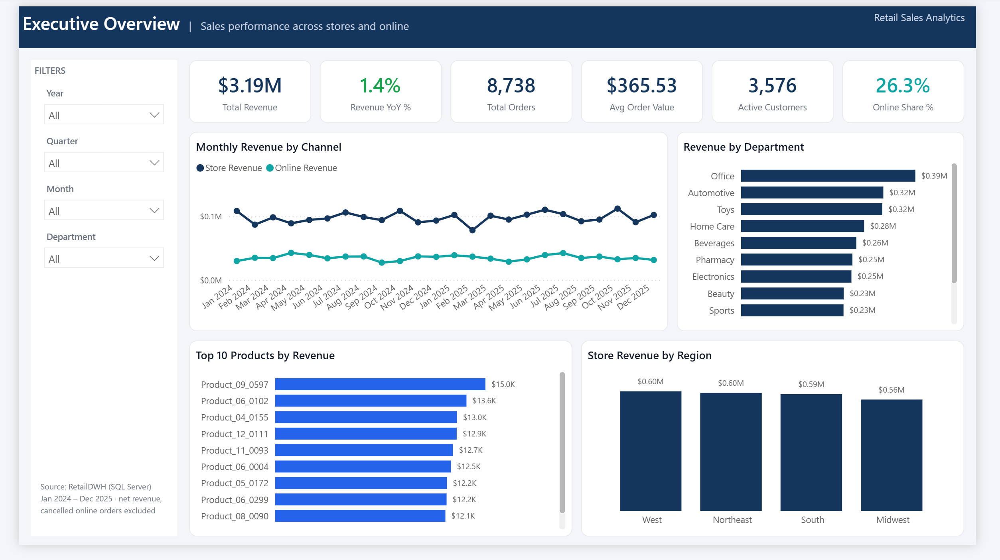
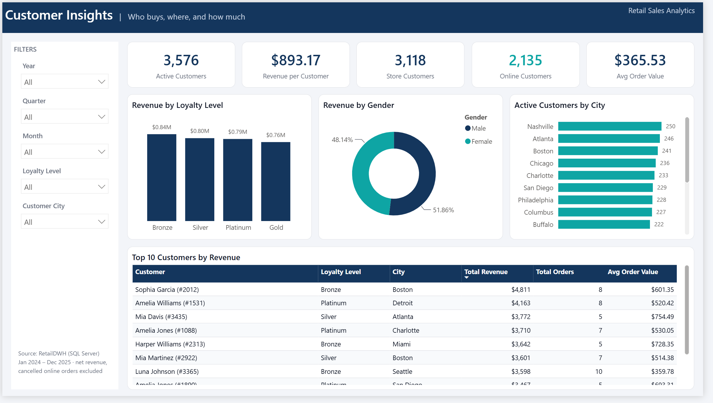
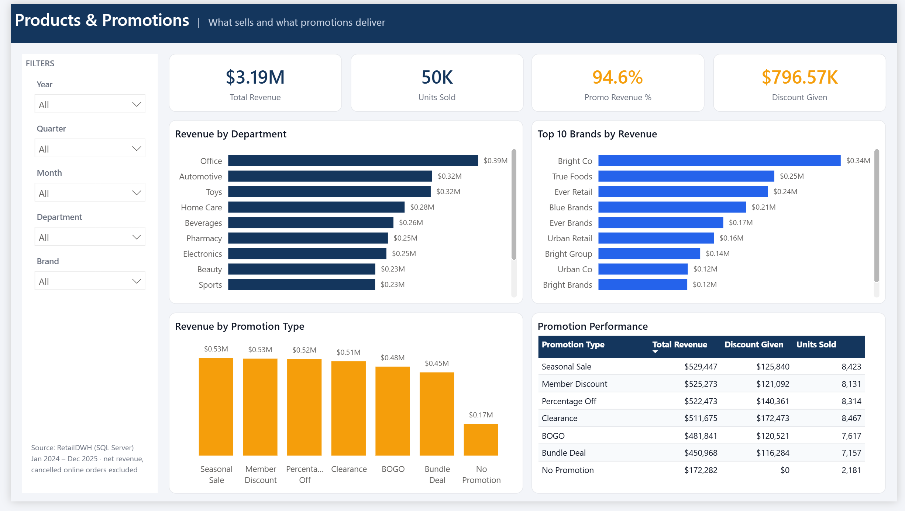
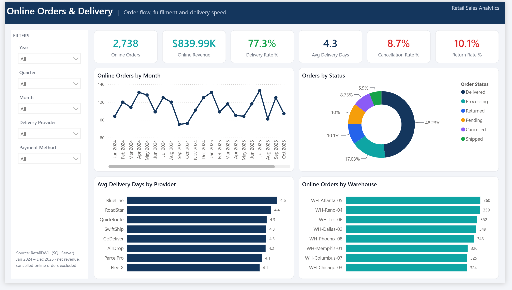
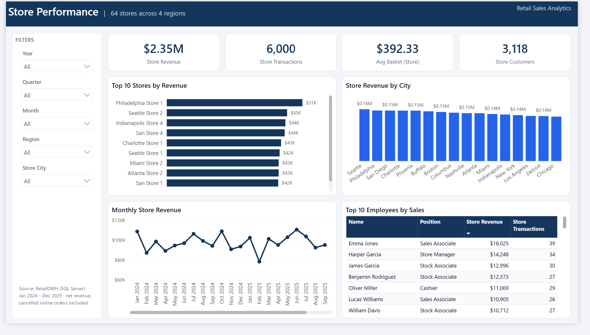

# Retail Sales Data Warehouse (SQL Server + Power BI)

An end-to-end data warehouse for a retailer that sells in **64 stores (POS)** and **online**. Nineteen raw CSV files are loaded into SQL Server with a **medallion architecture** (bronze → silver → gold), cleaned with documented rules, tested with an automated QA suite, and modelled as a star schema for a 5-page Power BI dashboard.

```
CSV files (19)  ──►  BRONZE  ──►  SILVER  ──►  GOLD  ──►  Power BI
                     raw text      typed,       star schema
                     as-is         cleaned,     2 facts, 8 dims
                                   deduplicated
                         └──────── etl.load_log: rows in / loaded / rejected per table ────────┘
                         └──────── qa schema: 100 automated checks after every load ─────────┘
```



**Data:** Jan 2024 – Dec 2025 · 6,000 POS transactions (14,962 lines) · 3,000 online orders (7,151 lines) · 4,000 customers · 600 products · 64 stores · 120 promotions.

---

## Repository layout

| File | What it does |
| --- | --- |
| `sql/00_setup.sql` | Creates the `RetailDWH` database, the `bronze`, `silver`, `gold`, `etl` schemas and the load log |
| `sql/01_bronze_ddl.sql` | 19 bronze tables, one per CSV, all text columns |
| `sql/02_bronze_load.sql` | `bronze.load_bronze @source_path`: bulk loads every CSV, logs each file, stops the run if any file fails |
| `sql/03_silver_ddl.sql` | Typed silver tables with primary keys and audit columns |
| `sql/04_silver_load.sql` | `silver.load_silver`: cleaning, deduplication, missing-value recovery, all in one transaction |
| `sql/05_gold.sql` | `gold.dim_date` table + 7 dimension views + 2 fact views, and `etl.run_pipeline` |
| `sql/06_qa_framework.sql` | Reusable QA engine (`qa` schema) |
| `sql/07_qa_suite.sql` | The project's data quality checks and report |

Requires **SQL Server 2017 or later** (uses `TRIM`, `CONCAT_WS`, `STRING_AGG`, `CREATE OR ALTER`).

---

## How to run

1. Copy the 19 CSV files into one folder **on the machine where SQL Server runs**, e.g. `D:\Projects\RetailDWH\datasets\`.
2. In SSMS, run `00` → `05` in order (once, or whenever you change the code).
3. Run `06_qa_framework.sql` once.
4. Load everything:
   ```sql
   EXEC RetailDWH.etl.run_pipeline @source_path = N'D:\Projects\RetailDWH\datasets\';
   ```
   The result grid shows every table with rows in, rows loaded, rows rejected and status.
5. Run `07_qa_suite.sql` and read the report: no FAIL or ERROR rows expected, and the WARN rows listed below.
6. In Power BI, point the data source at database `RetailDWH` (same table names as before).

If a step fails: `SELECT * FROM etl.load_log ORDER BY log_id DESC;` shows the table and the error. A bulk-load error about access to the file usually means the SQL Server service account can't read the folder.

---

## Data decisions

Every value that was fixed or filled is labelled in the data, so it can be filtered or audited.

| Issue in source | Rows | Decision | Where it's visible |
| --- | --- | --- | --- |
| Online line missing quantity or price | 150 | Order_Total always equals SUM(quantity × price), so the one missing value per order is **recovered exactly** from the order total (140 values). The rest: product median price (7) or quantity 1 (3) | `price_source`, `quantity_source` = `order_total` / `product_median` / `default_1` |
| POS line missing price | 300 | Product median POS price (no transaction total exists to recover from) | `price_source = 'product_median'` |
| POS line missing quantity | 50 | Quantity 1 | `quantity_source = 'default_1'` |
| Line has no promotion | 959 | `promotion_key = -1` "No Promotion", 0% discount | `dim_promotion` |
| Promotion with blank discount | 4 | 0% discount | `is_discount_missing` |
| Promotion end date before start date | 4 | Dates swapped | `is_dates_swapped` |
| Order status behind the delivery record ("Shipped" but delivered or returned) | 343 orders | Cancelled/Returned on the order win; otherwise the delivery record wins. Original kept | `order_status`, `order_status_source` |
| Order never shipped | 1,073 orders | `delivery_status = 'Not Shipped'`, delivery keys = Unknown | `fact_online_sales` |
| Delivery dated before shipping | 12 orders | Flagged; `delivery_days` left empty | `is_delivery_date_invalid` |
| Same email on different customers | 24 customers | Kept as separate customers, flagged for the business to confirm | `is_email_shared` |
| Duplicate names (201 names for 4,000 customers) | — | Unique `customer_label` = "Name (#ID)" for tables and visuals | `dim_customer.customer_label` |

`delivery_days` = days from ship to delivery, for **Delivered** orders only. `days_to_ship` = days from order to ship.

---

## Expected results

From the first full run on SQL Server 2022 (29 Oct 2026). An independent Python check of the same rules agreed on every count; revenue agreed within a few dollars (SQL rounds discount halves up).

| Check | Expected |
| --- | --- |
| Rows rejected in silver (all tables) | 0 |
| `gold.fact_online_sales` rows | 7,151 |
| `gold.fact_pos_sales` rows | 14,962 |
| Online net revenue, all statuses | 921,267.42 (2024: 461,333.26 · 2025: 459,934.16) |
| Online net revenue, excluding Cancelled | 839,986.08 |
| POS net revenue | 2,353,972.58 (2024: 1,167,191.17 · 2025: 1,186,781.41) |
| Online orders by final status | Delivered 1,447 · Processing 511 · Returned 303 · Pending 300 · Cancelled 262 · Shipped 177 |
| Average delivery days (Delivered lines) | 4.29 |
| Active customers (bought in any channel) | 3,576 of 4,000 |
| `gold.dim_date` | 2024-01-01 to 2026-12-31 (some deliveries arrive in 2026) |
| QA suite | 92 PASS · 8 WARN · 0 FAIL · 0 ERROR |

QA warnings you should see (all expected, all handled):

| Warning | Count |
| --- | --- |
| Order total differs from item lines (values estimated) | 3 orders |
| Deliveries dated before shipping | 12 |
| Promotions with dates swapped | 4 |
| Promotions with no discount | 4 |
| Customers sharing an email | 24 |
| Online lines with estimated values | 10 |
| POS lines with estimated values | 350 |
| POS net amount outliers (> 4 std dev) | 8 |

**Compared with the previous version:** online revenue was 901,281.59 and POS 2,302,878.75, because missing prices and quantities were loaded as 0. Recovering and estimating those values adds 19,986 online and 51,094 POS.

---

## Power BI dashboard

`powerbi/RetailDashboard.pbip` (Power BI Project, text-based and Git-friendly) and `RetailDashboard.pbix` (single file).

| Page | Answers |
| --- | --- |
| Executive Overview | Revenue, YoY growth, orders, AOV, active customers, online share; monthly trend by channel; departments; top products; regions |
| Customer Insights | Revenue per customer, loyalty levels, gender, cities, top 10 customers |
| Products & Promotions | Units, promo share, discount given; departments, top brands, promotion performance |
| Online Orders & Delivery | Delivery rate, delivery days, cancellation and return rates; status mix, providers, warehouses |
| Store Performance | Store revenue, transactions, basket size; top stores, cities, monthly trend, top employees |

### Screenshots

| Customer Insights | Products & Promotions |
| --- | --- |
|  |  |
| **Online Orders & Delivery** | **Store Performance** |
|  |  |

**Model:** star schema with 2 facts and 8 dimensions, a marked date table, an active order-date relationship for online sales (the delivery date is inactive and used through `USERELATIONSHIP`), and 29 measures in display folders. Revenue excludes cancelled online orders.

**Connection:** the Power Query parameters `Server` (default `localhost`) and `Database` (default `RetailDWH`). Change them under Transform data → Manage parameters.

**Rebuilding the report files:** `python tools/build_model.py` and `python tools/build_report.py` regenerate the model (TMDL) and pages (PBIR).
